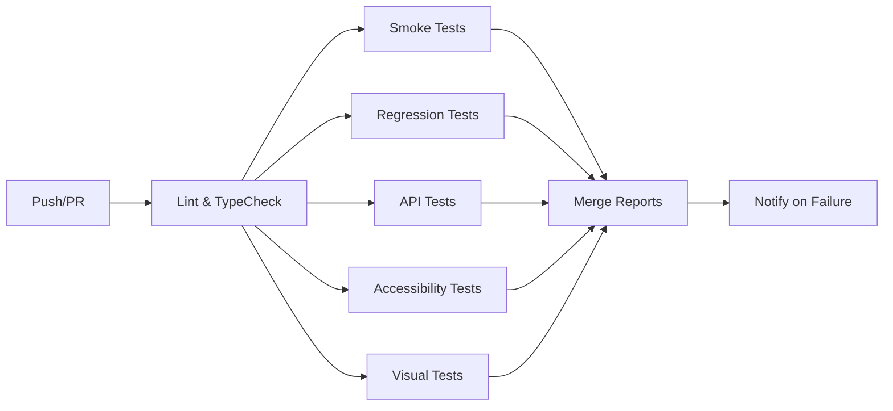

# Playwright QA Pipeline

[](https://github.com/zaito/Playwright-QA-Pipeline/actions/workflows/ci.yml)
[](https://github.com/zaito/Playwright-QA-Pipeline/actions/workflows/security.yml)
[](https://playwright.dev)
[](LICENSE)

**Enterprise-grade QA Automation Portfolio** — Playwright + TypeScript, multi-target test suite demonstrating E2E, API, Visual, Accessibility, Performance, and Security testing from a single toolchain.

## Target Applications

| Application | Type | Purpose | Base URL |
|-------------|------|---------|----------|
| **SauceDemo** | E2E / Visual / a11y | E-commerce flow (login, cart, checkout) | `https://www.saucedemo.com` |
| **Restful-Booker** | API | REST API CRUD + auth | `https://restful-booker.herokuapp.com` |
| **The Internet** | UI Components | Forms, dropdowns, dynamic loading, upload | `https://the-internet.herokuapp.com` |
| **JSONPlaceholder** | API | REST API (posts, users, albums, todos) | `https://jsonplaceholder.typicode.com` |
| **DemoQA** | UI Components | Text box, checkbox, radio, web tables | `https://demoqa.com` |

## What You Get

| Layer | Tool | Coverage |
|-------|------|----------|
| E2E, API, Visual | Playwright 1.60+ | Multi-browser (Chromium, Firefox, WebKit) |
| Accessibility | axe-core via `@axe-core/playwright` | WCAG 2.1 AA |
| Schema Validation | zod 4 | Test data & API responses |
| Security Scan | OWASP ZAP | Baseline scan in CI |
| Performance | Lighthouse CI | Core Web Vitals + a11y + SEO |
| Static Analysis | CodeQL | GitHub native |
| Secret Scanning | gitleaks | Pre-commit + CI |
| Dependency Review | GitHub Dependabot | PR gate |
| Pre-commit Gates | husky 9 + lint-staged | TypeScript, ESLint, Prettier |

## Quick Start

```bash
# 1. Clone & install
git clone https://github.com/zaito/Playwright-QA-Pipeline.git
cd Playwright-QA-Pipeline
npm install
npx playwright install --with-deps chromium

# 2. Configure (optional - defaults work out of the box)
cp .env.example .env.local
# Edit BASE_URLs if targeting different environments

# 3. Run smoke tests (all targets)
npm run test:smoke

# 4. Open HTML report
npm run report
```

## Test Commands

```bash
# Full suite
npm test

# By layer
npm run test:smoke        # Critical path (< 2 min)
npm run test:regression   # Full coverage
npm run test:api          # API contract tests
npm run test:a11y         # Accessibility (axe-core)
npm run test:visual       # Visual regression

# By target application
npm run test:saucedemo
npm run test:restful-booker
npm run test:the-internet
npm run test:jsonplaceholder
npm run test:demoqa

# Utilities
npm run test:ui           # Playwright UI mode
npm run test:debug        # Debug mode
npm run test:headed       # Headed browser
npm run test:visual:update # Update visual baselines
npm run report            # Show HTML report
npm run report:merge      # Merge sharded reports
npm run typecheck         # TypeScript check
npm run lint              # ESLint
npm run format            # Prettier format
npm run audit             # npm audit
npm run clean             # Clean artifacts
```

## Project Structure

```
.
├── src/
│   ├── pages/                    # Page Object Models (one per page/flow)
│   │   ├── BasePage.ts           # Abstract base class
│   │   ├── saucedemo/            # SauceDemo POMs
│   │   ├── the-internet/         # The Internet POMs
│   │   └── demoqa/               # DemoQA POMs
│   ├── components/               # Reusable sub-page objects
│   │   └── saucedemo/Header.ts
│   ├── api/                      # Typed REST API wrappers (zod-validated)
│   │   ├── RestfulBookerApi.ts
│   │   └── JsonPlaceholderApi.ts
│   ├── fixtures/                 # Playwright test extensions
│   │   ├── base.fixture.ts       # Page objects + worker-scoped auth
│   │   ├── global.setup.ts       # Env validation + cleanup
│   │   └── global.teardown.ts    # CI session wipe
│   ├── factories/                # Typed test-data factories
│   │   ├── shippingFactory.ts
│   │   └── index.ts
│   └── utils/
│       ├── testData.ts           # zod-validated JSON loader
│       ├── random.ts             # Crypto-backed random helpers
│       └── environmentCheck.ts   # Exponential backoff poller
├── tests/
│   ├── saucedemo/                # E2E + smoke + regression
│   ├── restful-booker/           # API CRUD + auth
│   ├── the-internet/             # UI components
│   ├── jsonplaceholder/          # API resources
│   ├── demoqa/                   # UI components + web tables
│   ├── accessibility/            # axe-core WCAG 2.1 AA
│   └── visual/                   # Screenshot diffs (per-browser)
├── test-data/                    # Static JSON, zod-validated at load
│   ├── users.json
│   └── products.json
├── .github/workflows/
│   ├── ci.yml                    # Main pipeline (lint, test, merge)
│   ├── security.yml              # CodeQL, gitleaks, ZAP, dependency review
│   └── lighthouse.yml            # Performance budgets
├── .husky/                       # pre-commit + pre-push hooks
├── playwright.config.ts          # Multi-project, sharded, merged reports
├── lighthouserc.yml              # Lighthouse CI budgets
├── tsconfig.json                 # Strict TS + path aliases
├── eslint.config.mjs             # TypeScript + Prettier
└── .prettierrc                   # Consistent formatting
```

## Page Object Model

Every page extends `BasePage` and follows the same shape. Locators are private, methods are named for user intent, no `expect()` lives in a POM.

```typescript
// src/pages/saucedemo/LoginPage.ts
export class LoginPage extends BasePage {
  protected readonly path = '/';

  private readonly username = this.page.getByTestId('username');
  private readonly password = this.page.getByTestId('password');
  private readonly submit = this.page.getByTestId('login-button');

  async waitForLoad(): Promise<void> {
    await this.page.locator('.login_logo').waitFor({ state: 'visible' });
  }

  async login(username: string, password: string): Promise<void> {
    await this.username.fill(username);
    await this.password.fill(password);
    await this.submit.click();
  }

  async loginAndWaitForInventory(username: string, password: string): Promise<void> {
    await this.login(username, password);
    await this.page.waitForURL('**/inventory.html');
  }
}
```

## Fixtures & Worker-Scoped Auth

```typescript
// src/fixtures/base.fixture.ts
export const test = base.extend({
  loginPage: async ({ page }, use) => {
    await use(new LoginPage(page));
  },
  authenticatedPage: async ({ browser }, use) => {
    const context = await browser.newContext();
    const page = await context.newPage();
    const loginPage = new LoginPage(page);
    await loginPage.goto();
    await loginPage.loginAndWaitForInventory(
      process.env.SAUCEDEMO_USERNAME!,
      process.env.SAUCEDEMO_PASSWORD!
    );
    await use(page);
    await context.close();
  },
});
```

## CI/CD Pipeline



- **Smoke + API** run on every push (< 2 min)
- **Full regression** runs nightly / on demand, sharded across Chromium/Firefox/WebKit
- **Reports merged** into single HTML artifact
- **PR comments** with failure summaries
- **Security** runs weekly + on PR (CodeQL, gitleaks, ZAP, Dependabot)
- **Lighthouse** runs on PR for performance budgets

## Environment Variables

| Variable | Description | Default |
|----------|-------------|---------|
| `SAUCEDEMO_BASE_URL` | SauceDemo URL | `https://www.saucedemo.com` |
| `SAUCEDEMO_USERNAME` | SauceDemo username | `standard_user` |
| `SAUCEDEMO_PASSWORD` | SauceDemo password | `secret_sauce` |
| `RESTFUL_BOOKER_BASE_URL` | Restful-Booker API | `https://restful-booker.herokuapp.com` |
| `THE_INTERNET_BASE_URL` | The Internet | `https://the-internet.herokuapp.com` |
| `JSONPLACEHOLDER_BASE_URL` | JSONPlaceholder API | `https://jsonplaceholder.typicode.com` |
| `DEMOQA_BASE_URL` | DemoQA | `https://demoqa.com` |

Set secrets in **GitHub Actions → Settings → Secrets** for CI.

## Adapting to Your App

1. Update `BASE_URL` in `.env.local` or GitHub secrets
2. Replace Page Objects in `src/pages/` with your app's pages
3. Update API wrappers in `src/api/` for your endpoints
4. Add test data in `test-data/`
5. Write tests in `tests/` using the same patterns

See [`GETTING_STARTED.md`](GETTING_STARTED.md) for detailed walkthrough.

## Documentation

- [`GETTING_STARTED.md`](GETTING_STARTED.md) — Zero-to-CI onboarding
- [`CLAUDE.md`](CLAUDE.md) — Coding standards for AI agents
- [`CONTRIBUTING.md`](CONTRIBUTING.md) — PR workflow + coding standards
- [`SECURITY.md`](SECURITY.md) — Secret handling + threat model
- [`TODO.md`](TODO.md) — Adapt-the-template checklist
- [`docs/flake-handling.md`](docs/flake-handling.md) — Flake taxonomy + playbook

## License

[MIT](LICENSE) — Free for personal and commercial use.