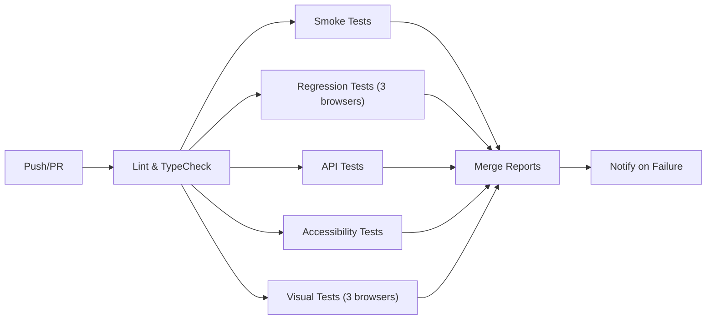

# Playwright QA Pipeline

[](https://github.com/dpgpqa/Playwright-QA-Pipeline/actions/workflows/ci.yml)
[](https://github.com/dpgpqa/Playwright-QA-Pipeline/actions/workflows/security.yml)
[](https://github.com/dpgpqa/Playwright-QA-Pipeline/actions/workflows/lighthouse.yml)
[](https://playwright.dev)
[](LICENSE)

An enterprise-grade QA pipeline for SaaS web apps. Clone, point at your app, ship with confidence. E2E · API · Visual · Accessibility · Performance · Security — from a single toolchain.

The template ships **pre-wired against [saucedemo.com](https://www.saucedemo.com)** so it works the moment you clone it. Adopt it by swapping `BASE_URL` to your app and adapting the page objects.

## What you get

| Layer              | Tool                                                                         | Cost           |
| ------------------ | ---------------------------------------------------------------------------- | -------------- |
| E2E, API, visual   | [Playwright](https://playwright.dev) 1.60+ + TypeScript                      | Free / OSS     |
| Accessibility      | [axe-core](https://github.com/dequelabs/axe-core) via `@axe-core/playwright` | Free / OSS     |
| Schema validation  | [zod](https://zod.dev) 4                                                     | Free / OSS     |
| Security scan      | [OWASP ZAP](https://www.zaproxy.org/) baseline scan                          | Free / OSS     |
| Performance        | [Lighthouse CI](https://github.com/GoogleChrome/lighthouse-ci)               | Free / OSS     |
| Static analysis    | [CodeQL](https://codeql.github.com/)                                         | Free on GitHub |
| Secret scanning    | [gitleaks](https://github.com/gitleaks/gitleaks)                             | Free / OSS     |
| Dependency review  | GitHub Dependabot + `dependency-review-action`                               | Free on GitHub |
| Pre-commit gates   | husky 9 + lint-staged 17                                                     | Free / OSS     |
| CI/CD              | GitHub Actions                                                               | Free tier      |
| Slack alerts       | Slack Incoming Webhooks                                                      | Free           |
| AI browser control | [@playwright/mcp](https://github.com/microsoft/playwright-mcp)               | Free / OSS     |
| Jira integration   | [mcp-atlassian](https://github.com/sooperset/mcp-atlassian) + `JiraApi.ts`   | Free / OSS     |

## Quick Start

```bash
# 1. Install
npm install
npx playwright install --with-deps chromium

# 2. Optional — point at your own app (defaults to saucedemo.com)
cp .env.example .env.local   # edit BASE_URL / TEST_USER_USERNAME / TEST_USER_PASSWORD

# 3. Smoke test
npm run test:smoke

# 4. Open the report
npm run report
```

You should see smoke tests pass against saucedemo.com. Full suite (`npm test`) runs all layers in under 2 minutes locally.

## Test Commands

```bash
# Full suite
npm test

# By layer
npm run test:smoke        # @smoke — critical path
npm run test:regression   # @regression — full coverage
npm run test:api          # @api — contract tests
npm run test:a11y         # @a11y — accessibility
npm run test:visual       # @visual — screenshot diffs

# Utilities
npm run test:ui           # Playwright UI mode
npm run test:debug        # Debug mode
npm run test:headed       # Headed browser
npm run test:visual:update # Update visual baselines
npm run report            # Show HTML report
npm run report:merge      # Merge sharded reports
npm run typecheck         # TypeScript check
npm run lint              # ESLint
npm run format            # Prettier format
npm run audit             # npm audit
npm run clean             # Clean artifacts
```

## Project Layout

```
.
├── src/
│   ├── pages/                    # POM: one file per page or major flow
│   │   ├── BasePage.ts           # abstract base — `goto()`, `waitForLoad()`
│   │   ├── LoginPage.ts
│   │   ├── InventoryPage.ts
│   │   ├── CartPage.ts
│   │   ├── CheckoutInfoPage.ts
│   │   ├── CheckoutOverviewPage.ts
│   │   └── CheckoutCompletePage.ts
│   │
│   ├── components/               # reusable sub-page objects
│   │   └── Header.ts             # cart badge, menu, logout, reset
│   │
│   ├── api/                      # typed REST wrappers with zod schemas
│   │   ├── SauceDemoApi.ts       # pattern reference — mirrors Jira wrapper shape
│   │   ├── RestfulBookerApiClient.ts
│   │   └── JiraApi.ts            # Jira REST wrapper (getTicket, createDefect, etc.)
│   │
│   ├── fixtures/                 # Playwright test extensions
│   │   ├── base.fixture.ts       # page objects + worker-scoped auth
│   │   ├── global.setup.ts       # env validation + stale-auth cleanup
│   │   └── global.teardown.ts    # CI session wipe
│   │
│   ├── factories/                # typed test-data factories
│   │   ├── userFactory.ts
│   │   ├── productFactory.ts
│   │   ├── bookingFactory.ts
│   │   └── index.ts
│   │
│   └── utils/
│       ├── testData.ts           # zod-validated JSON loader
│       ├── random.ts             # crypto-backed random helpers
│       └── environmentCheck.ts  # exponential backoff poller for BASE_URL
│
├── tests/
│   ├── smoke/                    # @smoke — critical path (< 2 min total)
│   ├── regression/               # @regression — full coverage, nightly
│   ├── api/                      # @api — contract + availability
│   ├── accessibility/            # @a11y — axe-core WCAG 2.1 AA
│   └── visual/                   # @visual — screenshot diffs
│
├── test-data/                    # static JSON, zod-validated at load
│   ├── users.json
│   └── products.json
│
├── agents/                       # Claude agent definitions
│   ├── test-writer.md            # write tests from feature descriptions
│   ├── triage.md                 # debug failing or flaky tests
│   ├── pom-builder.md            # create new Page Object classes
│   └── jira-qa-runner.md         # full Jira ticket → test → report → defect cycle
│
├── skills/                       # Claude skill definitions (atomic capabilities)
│   ├── write-test.md
│   ├── create-page-object.md
│   ├── generate-locator.md
│   ├── analyze-failure.md
│   ├── run-tests.md
│   ├── pull-jira-ticket.md       # extract AC from Jira tickets
│   ├── self-heal-test.md         # one-attempt selector/timing fix
│   ├── write-run-report.md       # write reports/runs/YYYY-MM-DD-<ticket>.md
│   ├── create-jira-defect.md     # dedup-checked defect creation
│   └── store-qa-memory.md        # persist patterns to Claude memory
│
├── commands/                     # Claude command playbooks
│   ├── test.md
│   ├── smoke.md
│   ├── lint.md
│   ├── update-snapshots.md
│   ├── new-page.md
│   ├── jira-qa-run.md            # end-to-end Jira QA runbook
│   └── check-environment.md      # poll BASE_URL until ready
│
├── docs/
│   ├── flake-handling.md         # expect.poll · test.slow · @quarantine
│   └── contacts.md               # team escalation, Jira keys, token rotation
│
├── .github/
│   ├── workflows/                # ci · security · lighthouse
│   ├── ISSUE_TEMPLATE/
│   ├── CODEOWNERS                # auto-assign reviewers per path
│   ├── PULL_REQUEST_TEMPLATE.md
│   └── dependabot.yml
│
├── .husky/                       # pre-commit + pre-push hooks
├── .auth/                        # gitignored — per-worker storage state
├── reports/                      # gitignored — HTML + JSON output
│   └── runs/                     # per-run Jira workflow reports (gitignored)
├── blob-report/                  # gitignored — sharded blob output
│
├── playwright.config.ts
├── lighthouserc.yml
├── eslint.config.mjs
├── tsconfig.json
├── package.json
├── SECURITY.md                   # secret handling + threat model
├── CONTRIBUTING.md               # PR + coding standards for humans
├── CLAUDE.md                     # PR + coding standards for AI agents
├── GETTING_STARTED.md            # full onboarding guide
├── TODO.md                       # adapt-the-template checklist
└── LICENSE
```

## AI-Assisted QA (Agents, Skills, Commands)

This template includes a **Claude Code automation layer** for QA workflows. See [`CLAUDE.md`](CLAUDE.md) for full rules.

### Agents (roles completos)

| Agent            | Purpose                                    |
| ---------------- | ------------------------------------------ |
| `test-writer`    | Write tests from feature descriptions      |
| `triage`         | Debug failing or flaky tests               |
| `pom-builder`    | Create Page Object classes                 |
| `jira-qa-runner` | Full ticket → test → report → defect cycle |

### Skills (capacidades atómicas reusables)

| Skill                | Purpose                                        |
| -------------------- | ---------------------------------------------- |
| `write-test`         | Atomic test writing from scenario              |
| `create-page-object` | Atomic POM creation                            |
| `generate-locator`   | Stable locator strategy (`getByTestId` first)  |
| `analyze-failure`    | Classify failure → recommend fix               |
| `run-tests`          | Execute tests, capture artifacts               |
| `pull-jira-ticket`   | Extract AC from Jira tickets                   |
| `self-heal-test`     | One-attempt selector/timing auto-fix           |
| `write-run-report`   | Generate `reports/runs/YYYY-MM-DD-<ticket>.md` |
| `create-jira-defect` | File Jira defect with dedup check              |
| `store-qa-memory`    | Persist learned patterns                       |

### Commands (playbooks paso a paso)

| Command             | Purpose                       |
| ------------------- | ----------------------------- |
| `test`              | Full suite playbook           |
| `smoke`             | Quick smoke run               |
| `lint`              | Code quality gates            |
| `update-snapshots`  | Regenerate visual baselines   |
| `new-page`          | POM → fixture → test workflow |
| `jira-qa-run`       | End-to-end Jira QA cycle      |
| `check-environment` | Poll `BASE_URL` until ready   |

### Uso

```bash
# En Claude Code / Hermes:
Use agents/jira-qa-runner to run QA cycle for PROJ-123
Use skills/write-test to create test for "user can add item to cart"
```

### Requisitos para Jira Integration

Configura estos secrets en GitHub Actions:

- `JIRA_BASE_URL` — ej. `https://your-company.atlassian.net`
- `JIRA_EMAIL` — tu email de Jira
- `JIRA_API_TOKEN` — token de API de Jira

---

## The Page Object Model

Every page extends `BasePage` and follows the same shape. Locators are private, methods are named for user intent, no `expect()` lives in a POM.

### Base class

```typescript
// src/pages/BasePage.ts
import { Page, Response } from '@playwright/test';

export abstract class BasePage {
  constructor(protected readonly page: Page) {}

  protected abstract readonly path: string;

  async goto(): Promise<Response | null> {
    const res = await this.page.goto(this.path);
    await this.waitForLoad();
    return res;
  }

  abstract waitForLoad(): Promise<void>;

  url(): string {
    return this.page.url();
  }
}
```

### Page class — the pattern

```typescript
// src/pages/LoginPage.ts
import { BasePage } from './BasePage';

export class LoginPage extends BasePage {
  protected readonly path = '/';

  // Private locator fields — never exposed to tests.
  private readonly username = this.page.getByTestId('username');
  private readonly password = this.page.getByTestId('password');
  private readonly submit = this.page.getByTestId('login-button');
  private readonly error = this.page.getByTestId('error');
  private readonly logo = this.page.locator('.login_logo');

  // Wait for a reliable page-ready indicator. No expect() — that belongs in tests.
  async waitForLoad(): Promise<void> {
    await this.logo.waitFor({ state: 'visible' });
  }

  // Method names describe user intent, not implementation details.
  async login(username: string, password: string): Promise<void> {
    await this.username.fill(username);
    await this.password.fill(password);
    await this.submit.click();
  }

  async loginAndWaitForInventory(username: string, password: string): Promise<void> {
    await this.login(username, password);
    await this.page.waitForURL('**/inventory.html');
  }

  async getErrorMessage(): Promise<string> {
    return (await this.error.textContent()) ?? '';
  }
}
```

### Component class — for shared UI

```typescript
// src/components/Header.ts
import { Page } from '@playwright/test';

export class Header {
  constructor(private readonly page: Page) {}

  private readonly menuButton = this.page.getByTestId('open-menu');
  private readonly logoutLink = this.page.getByTestId('logout');
  private readonly resetLink = this.page.getByTestId('reset');
  private readonly cartBadge = this.page.getByTestId('cart-badge');

  async openMenu(): Promise<void> {
    await this.menuButton.click();
  }

  async logout(): Promise<void> {
    await this.openMenu();
    await this.logoutLink.click();
  }

  async resetAppState(): Promise<void> {
    await this.openMenu();
    await this.resetLink.click();
  }

  async getCartCount(): Promise<number> {
    const text = await this.cartBadge.textContent();
    return text ? parseInt(text, 10) : 0;
  }
}
```

## Fixtures & Worker-Scoped Auth

Each Playwright worker logs in **once**, saves its session to `.auth/user-{workerIndex}.json`, and reuses it for all tests in that worker. No repeated logins, no shared state between workers.

```typescript
// src/fixtures/base.fixture.ts
export const test = base.extend<{
  loginPage: LoginPage;
  inventoryPage: InventoryPage;
  // ... other page objects
}>({
  loginPage: async ({ page }, use) => await use(new LoginPage(page)),
  inventoryPage: async ({ page }, use) => await use(new InventoryPage(page)),
  // ... other fixtures

  // Worker-scoped auth via storageState
  storageState: async ({}, use, workerInfo) => {
    const authFile = `.auth/user-${workerInfo.workerIndex}.json`;
    await use(authFile);
  },
});
```

- `global.setup.ts`: validates env, logs in once per worker, saves `.auth/user-{index}.json`
- `global.teardown.ts`: cleans up auth files on CI

## Tagging Strategy

| Tag           | Purpose                          | CI               |
| ------------- | -------------------------------- | ---------------- |
| `@smoke`      | Critical path, < 2 min total     | Every push       |
| `@regression` | Full coverage, nightly           | Nightly / PR     |
| `@api`        | Contract + availability          | Every push       |
| `@a11y`       | axe-core WCAG 2.1 AA             | Every push       |
| `@visual`     | Screenshot diffs                 | Every push       |
| `@quarantine` | Known flaky — handled separately | Excluded from CI |

Run: `npx playwright test --grep @smoke`

## CI/CD Pipeline



- **Smoke + API** run on every push (< 2 min)
- **Full regression** runs on push, sharded across Chromium/Firefox/WebKit
- **Reports merged** into single HTML artifact
- **Security** runs on push/PR + weekly (CodeQL, gitleaks, npm audit, OWASP ZAP, dependency-review)
- **Lighthouse** runs on push/PR for performance budgets

## Environment Variables

| Variable             | Description        | Default                     |
| -------------------- | ------------------ | --------------------------- |
| `BASE_URL`           | Target application | `https://www.saucedemo.com` |
| `TEST_USER_USERNAME` | Test username      | `standard_user`             |
| `TEST_USER_PASSWORD` | Test password      | **Required secret**         |

Set `TEST_USER_PASSWORD` in **GitHub Actions → Settings → Secrets** for CI.

Optional:

- `SLACK_WEBHOOK_URL` — for failure notifications
- `JIRA_BASE_URL`, `JIRA_EMAIL`, `JIRA_API_TOKEN` — for Jira integration

## Adapting to Your App

1. Change `BASE_URL` in `.env.local` (and GitHub secret)
2. Update page objects in `src/pages/` to match your UI
3. Update `data-test` attributes in your app or adjust locators
4. Add/remove tests in `tests/` to cover your flows
5. Update `lighthouserc.yml` budgets for your performance targets

See [`GETTING_STARTED.md`](GETTING_STARTED.md) for detailed walkthrough.

## Documentation

- [`GETTING_STARTED.md`](GETTING_STARTED.md) — zero-to-CI onboarding walkthrough
- [`CLAUDE.md`](CLAUDE.md) — coding standards, agent rules, POM patterns, security
- [`CONTRIBUTING.md`](CONTRIBUTING.md) — PR workflow + coding standards
- [`SECURITY.md`](SECURITY.md) — secret handling, threat model, reporting
- [`TODO.md`](TODO.md) — adapt-the-template checklist
- [`docs/flake-handling.md`](docs/flake-handling.md) — flake taxonomy + playbook
- [`docs/contacts.md`](docs/contacts.md) — team contacts, Jira keys, escalation, token rotation
- [`tests/visual/README.md`](tests/visual/README.md) — baseline-per-browser convention

## License

[MIT](LICENSE) — Free for personal and commercial use.
